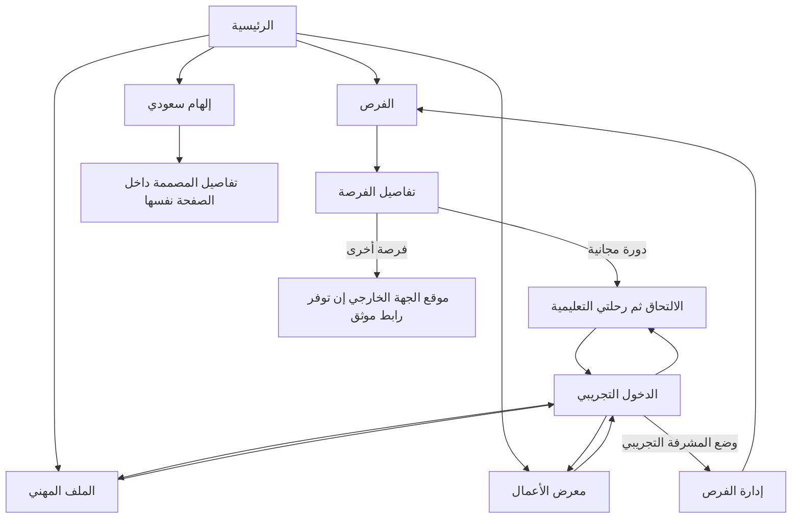

# SUDA — Sprint 1 navigation and demonstration flow

## Demo flows

- Visitor: home → opportunities → combined search/filter → details → login → free-course enrollment → learning progress.
- Designer: mock login → create/edit professional profile → add/edit/delete portfolio work (local compressed image) → manual progress and achievements.
- Supervisor: mock login with admin demo role → create/edit/delete opportunity across four categories → see changes reflected in browse/detail pages.
- Editorial: homepage lower teaser → inspiration → choose one of eight sourced designers → expanded details on the same page.
- Reset: footer action → confirmation → restore seed opportunities and clear per-user demo data.

No real authentication, backend, official external applications, or database integration in Sprint 1.
